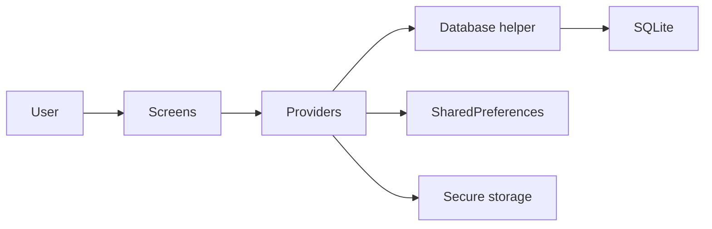

# eLista: An Offline Allowance and Wallet Tracker

**Track Your Wallet, Every Peso**

eLista is a fully offline allowance and expense tracker for students and other people who depend on an allowance. It has no accounts or bank integration; wallet data is stored locally on your phone.


## Features

### Core

- Record allowances and expenses; the expense form opens from the dashboard, defaults to Food, and can be saved in three taps (open form, focus amount, save) when using the default category.
- See the remaining balance calculated from recorded allowances minus expenses.
- Browse transaction history with All, Expenses, and Allowance filters, search, and edit or delete actions.

### Planning

- Set weekly or monthly budgets, including category budgets and an overall budget; view spending progress and budget warnings.
- Set an allowance end date to see days remaining and a daily safe-to-spend amount based on the remaining balance.

### Insights

- View a weekly spending chart and the highest-spending day.
- See computed insights for week-over-week spending changes, top spending category, allowance run-out projections, budget thresholds, no-spend days, daily average, and highest-spending day. Some insights appear only when their required transaction history or allowance period is available.

### Privacy and security

- Optional PIN lock. The app stores a salted SHA-256 hash in secure storage, not the PIN itself.
- No internet connection, account, or bank integration is required; the app operates on local data.

### Experience

- Light and dark themes with a blue-based palette.
- Animated logo and splash screen.
- First-run setup and an editable profile name.

## Tech stack

The versions below are the constraints written in `pubspec.yaml`, not necessarily the resolved versions in `pubspec.lock`.

| Layer | Technology | Version |
| --- | --- | --- |
| UI framework | Flutter SDK | Not pinned <!-- TODO: Record the Flutter SDK version if the project adopts a fixed version. --> |
| Language | Dart SDK constraint | `^3.10.0` |
| State management | provider | `^6.1.5+1` |
| Local database | sqflite | `^2.4.2+1` |
| File paths | path | `^1.9.1` |
| Local preferences | shared_preferences | `^2.5.5` |
| Secure storage | flutter_secure_storage | `^11.2.0` |
| Hashing | crypto | `^3.0.8` |
| Charts | fl_chart | `^1.3.1` |
| Dates and currency formatting | intl | `^0.20.3` |
| Splash generation | flutter_native_splash | `^2.4.7` |

## Architecture

- **Presentation:** screens and reusable widgets render the app and handle user input.
- **State management:** Provider-based wallet, budget, profile, theme, and PIN state; `InsightsService` computes local insights.
- **Data access:** `DbHelper` manages SQLite operations; providers read and write preferences and secure storage.
- **Storage:** SQLite, SharedPreferences, and Flutter Secure Storage all run on the device.



Everything in this flow runs on the device.

### Source tree

```text
lib/                      # Flutter application source
  main.dart
  database/                 # SQLite database access
    db_helper.dart
  models/                   # Transaction, budget, and weekly summary models
    budget_model.dart
    transaction_model.dart
    weekly_spending_summary.dart
  providers/                # App state and local preferences
    budget_provider.dart
    pin_lock_provider.dart
    profile_provider.dart
    theme_provider.dart
    wallet_provider.dart
  screens/                  # App pages and PIN gate
    add_transaction_screen.dart
    budget_screen.dart
    dashboard_screen.dart
    history_screen.dart
    insights_screen.dart
    main_navigation_screen.dart
    pin_lock_gate.dart
    settings_screen.dart
    setup_screen.dart
    splash_screen.dart
    statistics_screen.dart
  services/                 # Local insight calculations
    insights_service.dart
  theme/                    # Light and dark themes and design tokens
    app_theme.dart
  widgets/                  # Shared UI components and charts
    allowance_end_date_picker.dart
    allowance_period_card.dart
    dashboard_spending_chart.dart
    elista_logo.dart
    insights_preview_card.dart
    insight_row.dart
    primary_action_button.dart
    remaining_balance_card.dart
    screen_header.dart
    transaction_tile.dart
    weekly_spending_chart.dart
test/                       # Unit and widget tests
  insights_service_test.dart
  phase2_test.dart
  phase3_test.dart
  phase4_test.dart
  pin_lock_gate_test.dart
  pin_lock_provider_test.dart
  widget_test.dart
```

## Database

The app opens `elista.db` in the platform's SQLite database directory. The current schema version is **2**. Upgrading from a version before 2 adds `period_end_date` to `transactions`.

All columns below are declared by `db_helper.dart`; there are no additional `CHECK`, `UNIQUE`, or foreign-key constraints in the schema.

### `transactions`

| Column | SQLite type | Constraints |
| --- | --- | --- |
| `id` | INTEGER | Primary key, autoincrement |
| `type` | TEXT | NOT NULL |
| `amount` | REAL | NOT NULL |
| `category` | TEXT | Nullable |
| `note` | TEXT | Nullable |
| `date` | TEXT | NOT NULL |
| `created_at` | TEXT | NOT NULL |
| `period_end_date` | TEXT | Nullable |

### `budgets`

| Column | SQLite type | Constraints |
| --- | --- | --- |
| `id` | INTEGER | Primary key, autoincrement |
| `category` | TEXT | Nullable; a null category represents an overall budget |
| `limit_amount` | REAL | NOT NULL |
| `period` | TEXT | NOT NULL |
| `created_at` | TEXT | NOT NULL |

Budget spending counts expense transactions whose category exactly matches the budget category and whose dates fall in the budget period. Overall budgets have a null category and include all expense categories. Weekly periods start Monday; monthly periods use calendar months.

An allowance's optional end date is stored in that allowance transaction's `period_end_date` column.

Values stored outside SQLite:

- **SharedPreferences:** `profile_name`, `allowance_cycle`, `setup_complete`, and `dark_mode_enabled`.
- **Flutter Secure Storage:** `elista_pin_record`, containing the PIN salt and hash.

## Getting started

### Prerequisites

- Flutter SDK with a Dart SDK satisfying the `^3.10.0` constraint in `pubspec.yaml`. The project does not pin a Flutter SDK release.
- VS Code with Flutter/Dart support or Android Studio.
- An Android emulator or Android phone.
- Android application ID: `com.example.elista`. The app uses Flutter's configured `minSdk` and `targetSdk` values rather than pinning numbers in `build.gradle.kts`.

Clone and prepare the project:

```bash
git clone https://github.com/janeplacido-cs/eLista-An-Offline-Allowance-and-Expense-Tracker-.git
cd eLista-An-Offline-Allowance-and-Expense-Tracker-
flutter pub get
flutter doctor
flutter run
```

To run on an emulator, start an Android virtual device in Android Studio, then run `flutter run` from the project directory.

For a real Android phone, enable Developer options and USB debugging, connect the phone, authorize the computer on the phone, then run:

```bash
flutter devices
flutter run -d <device-id>
```

Build a release APK with:

```bash
flutter build apk --release
```

The APK is created at `build/app/outputs/flutter-apk/app-release.apk`.

Hot reload does not apply asset or plugin changes. Use a full restart; native plugin changes may require stopping and running the app again. The app has no environment variables or API keys to configure.

## Testing

Run static analysis and the test suite with:

```bash
flutter analyze
flutter test
```

The test files cover:

- `insights_service_test.dart`: week-over-week changes, top category, run-out projections, budget warnings, no-spend days, daily average, highest-spending day, and insight ordering.
- `phase2_test.dart`: expense form defaults and validation, setup and PIN, allowance entry and end dates, wallet totals, and history grouping, editing, deleting, searching, and filters.
- `phase3_test.dart`: weekly/monthly and category budget calculations, budget progress, and dashboard period controls.
- `phase4_test.dart`: allowance end-date mapping, allowance period status and safe-to-spend amount, weekly summaries, and the weekly chart.
- `pin_lock_provider_test.dart`: salted PIN hash storage and verification, PIN validation, changing/disabling a PIN, and invalid stored records.
- `pin_lock_gate_test.dart`: unlocking, relocking after backgrounding, and temporary lockout after incorrect attempts.
- `widget_test.dart`: theme behavior and persistence, profile-name editing, splash screen, and first-run setup.

## Privacy and security

- Transaction and budget data are stored on the device in SQLite; preferences and the PIN record use local storage.
- The app declares no Android internet permission, and its application code does not make network requests or use analytics.
- The PIN is stored as a salted SHA-256 hash in Flutter Secure Storage, not as plaintext.
- The SQLite database is **not encrypted at rest**.
- If the PIN is forgotten, the lock screen offers an erase flow. After confirmation, it deletes all transactions and budgets and removes the PIN. This cannot be undone; profile and theme preferences are not cleared by that flow.

## Known limitations and future work

- There is no backup or cloud sync. Data can be lost if the app is uninstalled or its app data is cleared.
- Currency formatting is fixed to Philippine pesos (₱).
- The database is not encrypted at rest.
- Android is configured in the project. <!-- TODO: Confirm Android is the tested platform. -->

Potential future work:

- [ ] Backup and restore
- [ ] Custom categories
- [ ] Recurring allowance
- [ ] Savings goals
- [ ] Reminders
- [ ] Fingerprint unlock
- [ ] iOS build

## About the project

Course project for **Application Development and Emerging Technologies**, BSCS 3C, School of Technology and Computer Studies, Biliran Province State University. Instructor: **Ms. Mary Angel Palma**.

**Group 2:** Placido, Jane Marie D.; Buaco, Nolyn Ross; Villamor, Charles David; Entroliso, JCyrus; Padayao, Kian; Delda, Anz; Buscay, Mark Ronald.

Design: <!-- TODO: Add the Figma file URL. -->

## License

<!-- TODO: Choose a license for this project. -->
